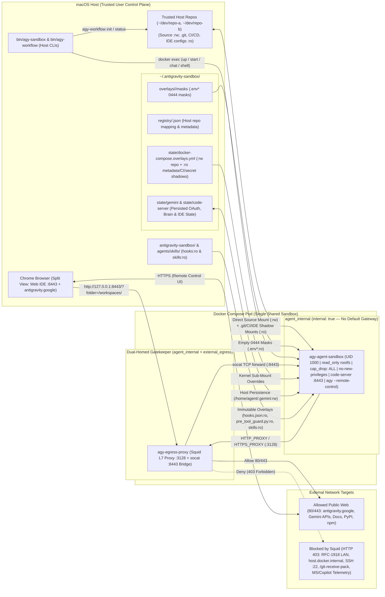

# Antigravity Enterprise Sandbox (`antigravity-sandbox`)

A defense-in-depth, zero-trust, **multi-repository** local sandboxing architecture for running **Google Antigravity** AI agents (`agy --remote-control`) and **code-server** Web IDE instances on macOS (Apple Silicon).

This setup enforces **OS-, container-, VFS-, and network-level security boundaries** using **Direct Source Mounts (`:rw`) with Read-Only Metadata & CI/CD Shadow Mounts (`:ro`)**:
* Your repository source tree is mounted directly at `/workspaces/<repo>:rw` for zero-friction editing and instant host visibility.
* Repository metadata (`.git`), Git hooks (`.git/hooks`), CI/CD pipelines (`.github`, `.circleci`, `.buildkite`, `.gitlab-ci.yml`, `Jenkinsfile`, etc.), and IDE execution configs (`.vscode`, `.idea`) are overlaid with **kernel-enforced read-only (`:ro`) bind mounts**.
* Host secrets (`.env*`) are strictly masked with empty `0444` `:ro` files.
* A host-side Git `pre-commit` guard prevents accidentally staging or committing changes to protected CI/CD, IDE, or metadata paths unless explicitly authorized on the host (`AGY_ALLOW_PROTECTED_COMMIT=1`).

---

## 1. Architecture & Container Topology



---

## 2. Security Boundaries & Read-Only Metadata Shadowing

### A. Two-Network Airlock (`docker-compose.yml`)
* **`agy-agent-sandbox` (`agent_internal` only)**:
  * Attached **exclusively** to a Docker bridge configured with `internal: true`.
  * Has **no default network gateway**—any process that attempts a direct raw TCP/UDP connection to the internet or host network (bypassing `HTTP_PROXY`) is dropped immediately by the Linux kernel.
  * Runs as non-root `agent` (`UID 1000:1000`) with a read-only root filesystem (`read_only: true`), `cap_drop: [ALL]`, `security_opt: [no-new-privileges:true]`, and `tini` as PID 1.
* **`agy-egress-proxy` (`agent_internal` + `external_egress`)**:
  * Dual-homed gatekeeper proxy routing outbound traffic and forwarding port `8443`.

### B. Direct Source Mounts (`:rw`) + Kernel-Enforced Metadata Shadowing (`:ro`)
1. **Read-Only `.git` Metadata & Hooks**:
   * Each registered repository's `.git` directory is mounted `:ro` (`/workspaces/<repo>/.git:ro`), and `.git/hooks` is masked with an empty `:ro` directory.
   * `GIT_OPTIONAL_LOCKS=0` allows read-only Git operations (`git status`, `git diff`, `git log`) inside the sandbox while preventing any tampering with `.git/config`, `.git/hooks`, `.git/objects`, or `.git/info/attributes`.
2. **CI/CD & IDE Auto-Execution Protection**:
   * Protected directories (`.github`, `.circleci`, `.buildkite`, `.husky`, `.vscode`, `.idea`, `.agents`, `.agent`) and CI/metadata files (`.gitlab-ci.yml`, `Jenkinsfile`, `.gitattributes`, `.gitmodules`, `.pre-commit-config.yaml`, `.envrc`, `.mise.toml`) are shadowed with `:ro` mounts inside the container.
   * Because active mount points in the Linux VFS cannot be unlinked or overwritten via `rename()`/`mv` (`EBUSY`/`EROFS`), processes inside the container cannot replace or inject CI workflows or IDE launch tasks.
3. **Secret Masking (`.env*`)**:
   * Existing host secrets (`.env`, `.env.local`, `.env.*`) are shadowed with empty `0444` `:ro` files inside the container, and `/.env` and `/.env.local` are added to `.git/info/exclude` so mount target files never pollute host `git status`. (Non-existent secrets are protected at the tool layer by `pre_tool_guard.py` without creating nested mount points).
4. **Deterministic `PreToolUse` Guard (`hooks/pre_tool_guard.py`) + Host `pre-commit` Guard**:
   * Inspects all `agy` commands and tool calls: blocks `git push`, remote mutations, secret access, CI/CD workflow edits, IDE task hijacking, and cross-repository writes.
   * Installs a host-side `.git/hooks/pre-commit` guard that blocks committing staged changes to CI/CD, IDE, or metadata paths unless `AGY_ALLOW_PROTECTED_COMMIT=1` is set on the host.

---

## 3. Quick Start & Workflow

### Step 1: Add `bin/` to your macOS `PATH`
```bash
export PATH="$HOME/antigravity_workspace/antigravity-sandbox/bin:$PATH"
# Or from your cloned repository directory:
# export PATH="$(pwd)/bin:$PATH"
```

### Step 2: One-Time Authentication (`agy-sandbox auth`)
```bash
agy-sandbox auth
# Or import existing host credentials:
agy-sandbox auth --import-host
```
* Persisted permanently on your Mac under `~/.antigravity-sandbox/state/gemini`.

### Step 3: Launch Any Repository
```bash
agy-workflow start ~/antigravity_workspace/my-project
# Or launch both IDE and Antigravity Chat as standalone Chrome App windows:
agy-workflow start --app ~/antigravity_workspace/my-project
```
* **Auto-Opens Browser Tabs / App Windows**:
  1. Dedicated **`code-server` Web IDE window** (`http://127.0.0.1:8443/?folder=/workspaces/my-project`).
  2. Live **Antigravity Chat Web UI** (`https://antigravity.google.com/r/<uuid>`).
* **AI Tab Autocomplete**: Pre-configured with automatic silent model fallback. Run `agy-sandbox auth --api-key <KEY>` once to activate.
* **Native IDE Option**: Run `agy-workflow ide --native` to open Cursor or VS Code directly on macOS.
* **App Windows**: Use `agy-workflow ide --app` and `agy-workflow chat --app` (or `agy-workflow start --app`) for chromeless app windows.

---

## 4. Source Control Workflow on Host

Because source files are mounted `:rw` while `.git` and CI/CD configs are `:ro`:
* **Immediate Visibility**: Edits made by the agent inside `/workspaces/<repo>` are immediately visible in your host working tree—no overlay toggling or syncing required.
* **Committing & Pushing**: Run `git diff`, `git add`, `git commit`, and `git push` directly on your macOS host.
* **Intentional Host CI/Metadata Edits**: If you edit `.github/workflows/*` or `.vscode/*` on your host and want to commit them, run:
  ```bash
  AGY_ALLOW_PROTECTED_COMMIT=1 git commit -m "ci: update workflow"
  ```

---

## 5. Command Reference

### Daily Repository & Session Workflow (`agy-workflow`)
```bash
agy-workflow start [--app|--native] [--tui] [--no-remote] [dir] # Register repo, ensure pod up, open IDE + chat UI
agy-workflow init [dir]                                         # Register host repo and configure :ro metadata/CI/secret guards
agy-workflow status [-c|--compact]                              # Show sandbox status and host git status
agy-workflow ide [--app|--native|--browser] [dir]               # Open code-server Web IDE (or --app Chrome window / --native IDE)
agy-workflow chat [--app|--tui] [-r|--restart] [dir]            # Open Antigravity Chat UI (Chrome / --app window, or terminal TUI)
```

### Pod Infrastructure & Admin (`agy-sandbox`)
```bash
agy-sandbox up [--rebuild] [dir]                # Start or rebuild the shared sandbox containers
agy-sandbox down                                # Stop the sandbox pod
agy-sandbox update                              # Fast-update the sandbox 'agy' CLI (cached OS layers) & restore sessions
agy-sandbox verify-isolation (or verify)        # Run the automated security & isolation test suite
agy-sandbox auth|login [-i|--import-host] [dir] # Interactive one-time authentication (-i to import host credentials)
agy-sandbox auth --api-key <KEY>                # Configure Gemini API key for AI Tab Autocomplete
agy-sandbox list                                # List all registered repositories and their URLs
agy-sandbox shell [dir]                         # Open an interactive bash shell inside /workspaces/<repo>
```

---

## 6. Running Unit & Integration Tests

```bash
python3 -m unittest discover -s tests -p "test_*.py" -v
agy-sandbox verify-isolation
```
