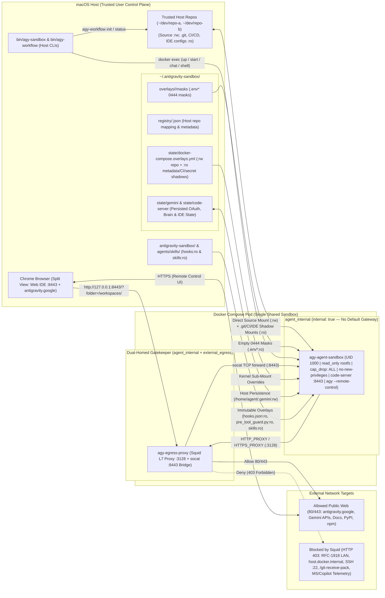

# Antigravity Enterprise Sandbox (`antigravity-sandbox`)

A defense-in-depth, zero-trust, **multi-repository** local sandboxing architecture for running **Google Antigravity** AI agents (`agy --remote-control`) and **code-server** Web IDE instances on macOS (Apple Silicon).

This setup enforces **OS-, container-, VFS-, and network-level security boundaries** using **Direct Source Mounts (`:rw`) with Read-Only Metadata & CI/CD Shadow Mounts (`:ro`)**:
* Your repository source tree is mounted directly at `/workspaces/<repo>:rw` for zero-friction editing and instant host visibility.
* Repository metadata (`.git`), Git hooks (`.git/hooks`), CI/CD pipelines (`.github`, `.circleci`, `.buildkite`, `.gitlab-ci.yml`, `Jenkinsfile`, etc.), and IDE execution configs (`.vscode`, `.idea`) are overlaid with **kernel-enforced read-only (`:ro`) bind mounts**.
* Host secrets (`.env*`) are strictly masked with empty `0444` `:ro` files.
* A host-side Git `pre-commit` guard prevents accidentally staging or committing changes to protected CI/CD, IDE, or metadata paths unless explicitly authorized on the host (`AGY_ALLOW_PROTECTED_COMMIT=1`).

---

## 1. Developer Environment Overview

The Antigravity Enterprise Sandbox isolates autonomous AI agent execution inside a hardened Linux container while giving you a familiar, flexible developer experience.

### Architecture at a Glance
The developer environment is split into two coordinated planes:

1. **Hardened Container Pod (Docker Compose)**:
   * **`agy-agent-sandbox`**:
     * **In-Container VS Code Server (`code-server`)**: Runs an in-container VS Code server listening on port `8443` with pre-installed extensions (such as Continue for AI tab autocompletion).
     * **Google Antigravity Agent (`agy`)**: Runs inside background `tmux` sessions (`agy --project <repo> --remote-control`), communicating securely with the Google Antigravity web control plane.
     * **Direct Source Mounts**: Your project source directories are mounted directly at `/workspaces/<repo>:rw` so container edits immediately reflect on your host machine.
     * **Kernel-Enforced Protection**: Critical metadata (`.git`), CI/CD configs (`.github`, `.circleci`, `.buildkite`, etc.), IDE configurations (`.vscode`, `.idea`), and secrets (`.env*`) are shadowed with read-only (`:ro`) mounts. Active mount points cannot be unlinked or overwritten by the container.
     * **Strict Network Isolation**: Attached strictly to an `internal: true` Docker bridge with no default network gateway.
   * **`agy-egress-proxy`**:
     * A dual-homed Squid L7 proxy and `socat` TCP bridge.
     * Exposes code-server port 8443 safely to host `127.0.0.1:8443`.
     * Inspects and filters outbound HTTP/HTTPS egress (allowing official Antigravity/Gemini APIs, PyPI, npm, and documentation sites while dropping private LAN, AWS/cloud metadata, SSH, and Copilot/telemetry traffic).

2. **Two Developer Interface Modes**:
   * **Web IDE Mode (Default)**:
     * Access the in-container VS Code server directly via a web browser or standalone chromeless Chrome app window (`http://127.0.0.1:8443/?folder=/workspaces/<repo>`).
     * Alongside the Web IDE, the Antigravity Chat UI (`https://antigravity.google.com/r/<uuid>`) runs in your browser to supervise and prompt the AI agent.
   * **Native Mode (Cursor or VS Code on macOS)**:
     * Run **Cursor** (or VS Code) natively on your host machine, pointing directly at the host repository folder.
     * The Antigravity agent runs concurrently inside the sandbox container. Because source files are mounted `:rw`, agent file changes appear immediately in your native Cursor editor, and your edits are immediately visible to the agent.
     * You retain all native IDE advantages: Cursor's local AI features, host language servers, personal extensions, keybindings, and macOS-native performance.

---

## 2. Prerequisites

Before using the sandbox, verify that the following components are installed on your host machine:

### Core Requirements
* **Docker Desktop** (or **OrbStack**):
  * Required for Docker Compose v2 support and container management.
  * [Install Docker Desktop for Mac (Apple Silicon)](https://www.docker.com/products/docker-desktop/) or [OrbStack](https://orbstack.dev/).
  * **Resource Allocation**: Ensure Docker Desktop has at least **4 GB of RAM** (8 GB recommended) allocated under `Settings -> Resources`. Ensure the Docker daemon is running before starting the sandbox.
* **macOS** (Apple Silicon M1/M2/M3/M4 recommended) or Linux:
  * The sandbox container is built for `linux/arm64` by default.
* **Git**:
  * Installed natively on the host (`xcode-select --install` or `brew install git`).
  * Used for host-side commits, branch switching, and installing the host `pre-commit` guard.
* **Python 3** (3.9 or higher):
  * Pre-installed on macOS or available via Homebrew (`brew install python3`).
  * Required on the host to execute verification tests and host-side pre-commit validation.

### Recommended Browsers & Tools
* **Google Chrome** (or Chromium-based browser):
  * Enables standalone chromeless app windows for the Web IDE (`agy-workflow ide --app`) and Antigravity Chat (`agy-workflow chat --app`).
  * [Download Google Chrome](https://www.google.com/chrome/).

### Requirements for Native IDE Mode (Cursor / VS Code)
If you plan to use Native IDE Mode instead of the in-browser Web IDE:
* **Cursor** (recommended) or **Visual Studio Code**:
  * [Download Cursor](https://www.cursor.com/) or [Download VS Code](https://code.visualstudio.com/).
* **CLI Launcher installed on `$PATH`**:
  * **Cursor**: Open Cursor, press `Cmd + Shift + P`, select **`Shell Command: Install 'cursor' command in PATH`**.
  * **VS Code**: Open VS Code, press `Cmd + Shift + P`, select **`Shell Command: Install 'code' command in PATH`**.
  * Verify in terminal:
    ```bash
    which cursor # Should output /usr/local/bin/cursor or similar
    # or
    which code   # Should output /usr/local/bin/code or similar
    ```

### Antigravity & AI Accounts
* **Google Antigravity Account**:
  * An authorized account on [Google Antigravity](https://antigravity.google) for one-time interactive OAuth login (`agy-sandbox auth`).
* **Gemini API Key (Optional)**:
  * For AI Tab Autocomplete via Continue / local fallback proxy:
    ```bash
    agy-sandbox auth --api-key <YOUR_GEMINI_API_KEY>
    ```

---

## 3. Architecture & Container Topology



---

## 4. Security Boundaries & Read-Only Metadata Shadowing

### A. Two-Network Airlock (`docker-compose.yml`)
* **`agy-agent-sandbox` (`agent_internal` only)**:
  * Attached **exclusively** to a Docker bridge configured with `internal: true`.
  * Has **no default network gateway**—any process that attempts a direct raw TCP/UDP connection to the internet or host network (bypassing `HTTP_PROXY`) is dropped immediately by the Linux kernel.
  * Runs as non-root `agent` (`UID 1000:1000`) with a read-only root filesystem (`read_only: true`), `cap_drop: [ALL]`, `security_opt: [no-new-privileges:true]`, and `tini` as PID 1.
* **`agy-egress-proxy` (`agent_internal` + `external_egress`)**:
  * Dual-homed gatekeeper proxy routing outbound traffic and forwarding port `8443`.

### B. Direct Source Mounts (`:rw`) + Kernel-Enforced Metadata Shadowing (`:ro`)
1. **Read-Only `.git` Metadata & Hooks**:
   * Each registered repository's `.git` directory is mounted `:ro` (`/workspaces/<repo>/.git:ro`), and `.git/hooks` is masked with an empty `:ro` directory.
   * `GIT_OPTIONAL_LOCKS=0` allows read-only Git operations (`git status`, `git diff`, `git log`) inside the sandbox while preventing any tampering with `.git/config`, `.git/hooks`, `.git/objects`, or `.git/info/attributes`.
2. **CI/CD & IDE Auto-Execution Protection**:
   * Protected directories (`.github`, `.circleci`, `.buildkite`, `.husky`, `.vscode`, `.idea`, `.agents`, `.agent`) and CI/metadata files (`.gitlab-ci.yml`, `Jenkinsfile`, `.gitattributes`, `.gitmodules`, `.pre-commit-config.yaml`, `.envrc`, `.mise.toml`) are shadowed with `:ro` mounts inside the container.
   * Because active mount points in the Linux VFS cannot be unlinked or overwritten via `rename()`/`mv` (`EBUSY`/`EROFS`), processes inside the container cannot replace or inject CI workflows or IDE launch tasks.
3. **Secret Masking (`.env*`)**:
   * Existing host secrets (`.env`, `.env.local`, `.env.*`) are shadowed with empty `0444` `:ro` files inside the container, and `/.env` and `/.env.local` are added to `.git/info/exclude` so mount target files never pollute host `git status`. (Non-existent secrets are protected at the tool layer by `pre_tool_guard.py` without creating nested mount points).
4. **Deterministic `PreToolUse` Guard (`hooks/pre_tool_guard.py`) + Host `pre-commit` Guard**:
   * Inspects all `agy` commands and tool calls: blocks `git push`, remote mutations, secret access, CI/CD workflow edits, IDE task hijacking, and cross-repository writes.
   * Installs a host-side `.git/hooks/pre-commit` guard that blocks committing staged changes to CI/CD, IDE, or metadata paths unless `AGY_ALLOW_PROTECTED_COMMIT=1` is set on the host.

---

## 5. Quick Start & Workflow

### Step 1: Add `bin/` to your macOS `PATH`
```bash
export PATH="$HOME/antigravity_workspace/antigravity-sandbox/bin:$PATH"
# Or from your cloned repository directory:
# export PATH="$(pwd)/bin:$PATH"
```

### Step 2: One-Time Authentication (`agy-sandbox auth`)
```bash
agy-sandbox auth
# Or import existing host credentials:
agy-sandbox auth --import-host
```
* Persisted permanently on your Mac under `~/.antigravity-sandbox/state/gemini`.

### Step 3: Launch Any Repository
```bash
agy-workflow start ~/antigravity_workspace/my-project
# Or launch both IDE and Antigravity Chat as standalone Chrome App windows:
agy-workflow start --app ~/antigravity_workspace/my-project
# Or launch with native macOS IDE (Cursor / VS Code):
agy-workflow start --native ~/antigravity_workspace/my-project
```
* **Auto-Opens Browser Tabs / App Windows**:
  1. Dedicated **`code-server` Web IDE window** (`http://127.0.0.1:8443/?folder=/workspaces/my-project`) or native **Cursor/VS Code**.
  2. Live **Antigravity Chat Web UI** (`https://antigravity.google.com/r/<uuid>`).
* **AI Tab Autocomplete**: Pre-configured with automatic silent model fallback. Run `agy-sandbox auth --api-key <KEY>` once to activate.
* **Native IDE Option**: Run `agy-workflow ide --native` to open Cursor or VS Code directly on macOS.
* **App Windows**: Use `agy-workflow ide --app` and `agy-workflow chat --app` (or `agy-workflow start --app`) for chromeless app windows.

---

## 6. Running the IDE in Native Mode (Cursor & VS Code)

While the sandbox includes an in-container `code-server` Web IDE accessible via any browser, you can also develop using your local native IDE (such as **Cursor** or **Visual Studio Code**) on macOS.

### Why Native Mode?
* **Native Desktop Experience**: Retain your native keyboard shortcuts, customized local extensions, themes, and macOS trackpad/window gestures.
* **Cursor AI & Copilot**: Leverage Cursor's native Copilot, inline chat, and local indexing features directly on the host.
* **Zero Latency**: Direct bind-mounts (`:rw`) ensure edits made by the containerized Antigravity agent update your native Cursor editor instantly without file transfer or synchronization delays.

### Requirements & Setup
To run the IDE in native mode, you need:
1. **Cursor or Visual Studio Code installed on macOS**:
   * [Cursor](https://www.cursor.com/) (recommended)
   * [Visual Studio Code](https://code.visualstudio.com/)
2. **CLI Launcher installed in your `$PATH`**:
   The workflow script detects `cursor` or `code` on your host `$PATH`:
   * **For Cursor**: Open Cursor -> press `Cmd + Shift + P` -> search and select **`Shell Command: Install 'cursor' command in PATH`**.
   * **For VS Code**: Open VS Code -> press `Cmd + Shift + P` -> search and select **`Shell Command: Install 'code' command in PATH`**.
   * **Verify**:
     ```bash
     command -v cursor || command -v code
     ```

### How to Launch in Native Mode
* **Start a Session in Native Mode**:
  ```bash
  # Launches sandbox pod, opens native Cursor/VS Code, and launches Antigravity Chat UI:
  agy-workflow start --native ~/dev/my-project
  ```
* **Open Native IDE for an Existing Session**:
  ```bash
  # From inside your project directory:
  agy-workflow ide --native

  # Or specify repository path:
  agy-workflow ide --native ~/dev/my-project
  ```
* **Make Native Mode the Default**:
  If you always prefer Cursor or VS Code over the web-based `code-server`, set this environment variable in your `~/.zshrc` or `~/.bashrc`:
  ```bash
  export AGY_IDE_MODE="native"
  ```
  With `AGY_IDE_MODE="native"`, commands like `agy-workflow start` and `agy-workflow ide` will automatically open your native editor without needing the `--native` flag.

### How Native Mode Works Behind the Scenes
```
┌────────────────────────────────────────────────────────┐
│                      macOS Host                        │
│                                                        │
│   Native IDE (Cursor / VS Code)                        │
│   ├── Direct editing on ~/dev/my-project (:rw)         │
│   └── Native Git commits (guarded by pre-commit hook)  │
│                                                        │
│   Antigravity Chat (Browser UI)                        │
│   └── https://antigravity.google.com/r/<uuid>          │
└──────────────────────────┬─────────────────────────────┘
                           │ Direct Source Mount (:rw)
                           ▼
┌────────────────────────────────────────────────────────┐
│           agy-agent-sandbox (Docker Container)         │
│                                                        │
│   Antigravity Agent (agy --remote-control)             │
│   ├── Edits /workspaces/my-project (:rw)               │
│   └── Blocked from .git, CI/CD, secrets (:ro)          │
│                                                        │
│   code-server (in-container VS Code server :8443)      │
│   └── Continues running in background if needed        │
└────────────────────────────────────────────────────────┘
```
1. `agy-workflow ide --native` inspects `$PATH`, picks `cursor` (or `code`), and opens the host repository path directly.
2. The `agy-agent-sandbox` container runs concurrently in Docker, executing Antigravity agent instructions.
3. When the agent creates or modifies files inside `/workspaces/<repo>`, changes immediately appear in your native Cursor window.
4. When you save changes in Cursor, the containerized agent immediately sees them.
5. All `.git`, CI/CD pipelines, and secrets remain read-only inside the container. You perform git commits directly from your host terminal or Cursor Git panel, enforced by the host Git `pre-commit` guard.

---

## 7. Source Control Workflow on Host

Because source files are mounted `:rw` while `.git` and CI/CD configs are `:ro`:
* **Immediate Visibility**: Edits made by the agent inside `/workspaces/<repo>` are immediately visible in your host working tree—no overlay toggling or syncing required.
* **Committing & Pushing**: Run `git diff`, `git add`, `git commit`, and `git push` directly on your macOS host.
* **Intentional Host CI/Metadata Edits**: If you edit `.github/workflows/*` or `.vscode/*` on your host and want to commit them, run:
  ```bash
  AGY_ALLOW_PROTECTED_COMMIT=1 git commit -m "ci: update workflow"
  ```

---

## 8. Command Reference

### Daily Repository & Session Workflow (`agy-workflow`)
```bash
agy-workflow start [--app|--native] [--tui] [--no-remote] [dir] # Register repo, ensure pod up, open IDE + chat UI
agy-workflow init [dir]                                         # Register host repo and configure :ro metadata/CI/secret guards
agy-workflow status [-c|--compact]                              # Show sandbox status and host git status
agy-workflow ide [--app|--native|--browser] [dir]               # Open code-server Web IDE (or --app Chrome window / --native IDE)
agy-workflow chat [--app|--tui] [-r|--restart] [dir]            # Open Antigravity Chat UI (Chrome / --app window, or terminal TUI)
```

### Pod Infrastructure & Admin (`agy-sandbox`)
```bash
agy-sandbox up [--rebuild] [dir]                # Start or rebuild the shared sandbox containers
agy-sandbox down                                # Stop the sandbox pod
agy-sandbox update                              # Fast-update the sandbox 'agy' CLI (cached OS layers) & restore sessions
agy-sandbox verify-isolation (or verify)        # Run the automated security & isolation test suite
agy-sandbox auth|login [-i|--import-host] [dir] # Interactive one-time authentication (-i to import host credentials)
agy-sandbox auth --api-key <KEY>                # Configure Gemini API key for AI Tab Autocomplete
agy-sandbox list                                # List all registered repositories and their URLs
agy-sandbox shell [dir]                         # Open an interactive bash shell inside /workspaces/<repo>
```

---

## 9. Running Unit & Integration Tests

```bash
python3 -m unittest discover -s tests -p "test_*.py" -v
agy-sandbox verify-isolation
```
